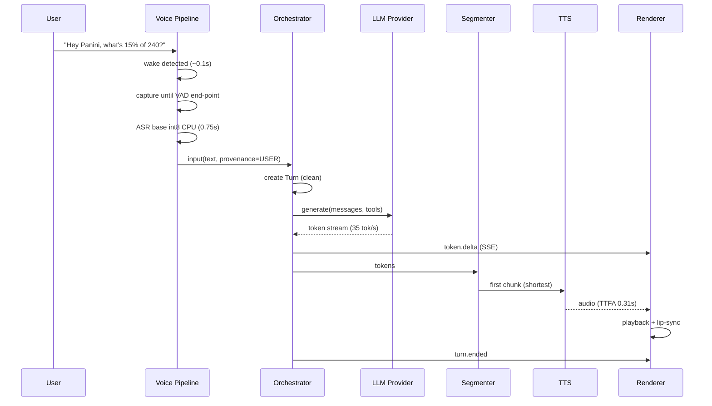
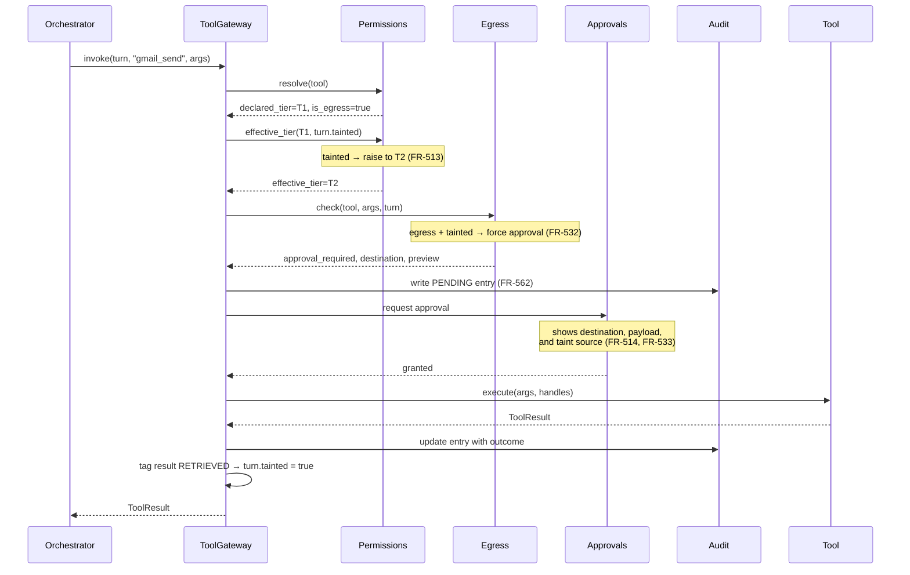

# Project Panini — High Level Design (HLD)

**Document Type:** High Level Design  
**Phase:** 04 — HLD  
**Version:** 1.0  
**Status:** DRAFT — awaiting review  
**Date:** 2026-09-09  

---

## Document Control

| Version | Date | Change |
|---|---|---|
| 1.0 | 2026-09-09 | Initial draft |

### Inputs

| Document | Provides |
|---|---|
| `03_FRD/01_Functional_Requirements_Document.md` | 131 functional requirements |
| `02_Solution_Design/01_Solution_Design_Document.md` | Layering, sourcing, patterns |
| `00_Discovery/05_Security/01_Threat_Model.md` | Controls SC-1 – SC-9 |
| `00_Discovery/.../02_Decision_Register.md` | Locked decisions |

### Scope

The HLD defines **components, their responsibilities, and the contracts between them**. It specifies interfaces at the level of operations and data shapes — not method signatures, database schemas, or algorithms. Those belong to the LLD.

---

## 1. Component Architecture

### 1.1 Backend decomposition

```
panini/
├── api/                    L1 TRANSPORT
│   ├── server              FastAPI application, lifespan
│   ├── ws_audio            Audio in/out WebSocket
│   ├── ws_chat             Chat WebSocket (text + streaming)
│   ├── sse_events          Server-sent event stream
│   └── routes/             health · config · audit · approvals
│
├── core/                   L2 ORCHESTRATION
│   ├── turn                Turn model — owns taint state
│   ├── conversation        Session, history, context assembly
│   ├── orchestrator        LLM loop + tool-call dispatch
│   ├── input_adapter       Voice/text → normalised input
│   └── output_router       Response → typed segments
│
├── security/               L3 SECURITY KERNEL  ⚠️ mandatory gate
│   ├── kernel              ToolGateway — the only path to tools
│   ├── provenance          USER / SYSTEM / RETRIEVED tagging
│   ├── taint               Per-turn taint state
│   ├── permissions         Tier resolution + escalation
│   ├── egress              Egress classification + destination check
│   ├── approvals           Approval request/response lifecycle
│   ├── credentials         Encrypted store, handle issuance
│   └── audit               Append-only audit writer
│
├── llm/                    L4 CAPABILITY
│   ├── provider            LLMProvider interface
│   ├── providers/          ollama · openai · anthropic · google
│   └── factory             Config → provider instance
│
├── tools/                  L4 CAPABILITY
│   ├── base                Tool interface + metadata
│   ├── registry            Registration, discovery, enable/disable
│   └── impl/               gmail · calendar · websearch · fs · shell · browser · mcp
│
├── plugins/                L4 CAPABILITY
│   ├── loader              Discovery, manifest parse, lifecycle
│   ├── verify              Signature verification
│   └── hooks               prompt_inject · pre_chat · post_turn
│
├── voice/                  L5 VOICE
│   ├── pipeline            Voice loop state machine
│   ├── asr/                ASREngine interface + faster-whisper
│   ├── tts/                TTSEngine interface + kokoro
│   ├── vad/                VADEngine interface + silero
│   ├── wakeword/           WakeWordEngine + openwakeword
│   ├── segmenter           Sentence/clause chunking for TTS
│   └── devices             Audio device management
│
├── store/                  L6 PERSISTENCE
│   ├── history             Conversation persistence
│   ├── audit_store         Append-only audit log
│   └── config              Load, validate, watch
│
└── events/                 CROSS-CUTTING
    └── bus                 Async pub/sub → SSE
```

### 1.2 Frontend decomposition

```
renderer/src/
├── app/                Shell, layout, routing
├── avatar/
│   ├── AvatarView      Driver-agnostic host
│   ├── drivers/vrm     Three.js + @pixiv/three-vrm
│   └── drivers/live2d  Optional (FR-307)
├── panels/             Code · Image · Video · Data · Diagram · Chart · Chat · Action
├── voice/              Mic capture, playback, interruption
├── security/           ApprovalDialog · ProviderIndicator · AuditView
├── input/              TextInput (FR-130)
└── transport/          WebSocket + SSE clients
```

### 1.3 Dependency rule

Dependencies point **downward only**. Two constraints are enforced structurally rather than by convention:

1. **`core/orchestrator` never imports `tools/registry`.** It receives only `security.kernel.ToolGateway`. There is no code path from orchestration to a tool that bypasses the kernel.
2. **`security/audit` is not reachable through `tools/impl/fs`.** The audit store path is excluded at the filesystem tool's root-resolution layer (FR-563).

---

## 2. Interface Contracts

Contracts are stated as operations and data shapes. Exact signatures are LLD.

### 2.1 LLMProvider

| Operation | Input | Output |
|---|---|---|
| `generate` | messages, tools, options | async stream of `{delta, tool_call?, done}` |
| `capabilities` | — | `{supports_tools, max_context, is_local}` |
| `health` | — | `{available, detail}` |

**Notes:** `is_local` drives the provider indicator (FR-550) and the cloud-switch acknowledgement (FR-551). `health` failure surfaces to the user; it never triggers a silent provider change (FR-214).

### 2.2 Tool

| Property / Operation | Purpose |
|---|---|
| `name`, `description`, `parameters` | Model-facing schema |
| `tier` | T0 – T3 (FR-402) |
| `is_egress` | Egress classification (FR-530) |
| `requires_credentials` | Handle names, never values (FR-542) |
| `execute(args, credential_handles)` | Returns `ToolResult` |

`ToolResult` = `{ok, content, content_type, error?, destination?}`.  
`destination` is populated by egress tools and drives the approval preview (FR-533).

### 2.3 ToolGateway — the security kernel façade

**This is the only interface the orchestrator has to tools.**

| Operation | Behaviour |
|---|---|
| `list_available(turn)` | Enabled tools only (FR-404) |
| `invoke(turn, tool_name, args)` | Executes the full gate sequence (§4.2) |

`invoke` returns `ToolResult` or an `ApprovalDenied` outcome. It **never** returns a raw tool result without having passed provenance tagging and taint update.

### 2.4 Voice engine interfaces

| Interface | Operation | Notes |
|---|---|---|
| `ASREngine` | `transcribe(audio, hints) → text` | `hints` carries vocabulary biasing (FR-113) |
| `TTSEngine` | `synthesize(text, voice) → audio` | Called per chunk, not per utterance |
| `VADEngine` | `is_speech(frame) → bool` | Frame-level |
| `WakeWordEngine` | `detect(frame) → bool` | Suppressible while speaking (FR-103) |

All four resolve through factories from config (FR-115, DD-021, DD-023).

### 2.5 EventBus

| Operation | Purpose |
|---|---|
| `publish(event_type, payload)` | Fan out to subscribers |
| `subscribe(types) → async iterator` | Consumed by the SSE endpoint |

**Event types:** `turn.started` · `turn.ended` · `token.delta` · `segment.emitted` · `tool.invoked` · `approval.requested` · `approval.resolved` · `voice.state` · `avatar.emotion` · `provider.changed` · `error`

---

## 3. Data Model (conceptual)

### 3.1 Turn — the taint scope

```
Turn
├─ id, session_id, started_at, ended_at
├─ input          { text, modality: voice|text, provenance: USER }
├─ context        [ ContextElement ]
├─ tainted        bool          ← monotonic within the turn (FR-511)
├─ taint_sources  [ string ]    ← shown in approval prompts (FR-514)
├─ invocations    [ ToolInvocation ]
├─ segments       [ OutputSegment ]
└─ state          TurnState
```

### 3.2 ContextElement

```
ContextElement
├─ content
├─ provenance   USER | SYSTEM | RETRIEVED     (FR-501)
├─ source       "gmail:msg-123" | "web:example.com" | "user"
└─ added_at
```

Adding an element with `provenance = RETRIEVED` sets `turn.tainted = true` and appends to `taint_sources`. **This is the single mutation that drives the entire content-initiated security model.**

### 3.3 ToolInvocation

```
ToolInvocation
├─ tool_name, args
├─ declared_tier, effective_tier        ← escalation recorded (FR-513)
├─ is_egress, destination
├─ approval { required, granted, prompt_shown_at, resolved_at }
├─ outcome { ok, error }
└─ audit_id
```

Recording both `declared_tier` and `effective_tier` makes escalation auditable — it shows *why* a prompt appeared.

### 3.4 OutputSegment

```
OutputSegment
├─ content_type   text|code|image|video|data|diagram|chart|action
├─ content
└─ metadata       { language?, alt?, ... }
```

Unrecognised `content_type` renders as `text` (FR-222).

---

## 4. Key Flows

### 4.1 Voice turn — no tools



**Composite measured latency: ≈1.8–2.2 s to first audio.**

### 4.2 Tool call through the security kernel ⚠️

This is the flow that implements the threat model.



**Three steps distinguish this from a conventional permission model:**

| Step | Why it matters |
|---|---|
| Tier escalation on taint | Blocks the confused-deputy chain without relying on the model |
| Egress check independent of tier | Catches exfiltration disguised as retrieval (T-07) |
| Result tagging → taint | A tool's *output* is untrusted; reading email taints the turn |

### 4.3 Interruption

```
User speaks while assistant is speaking
  → VAD detects speech + wake-suppression is lifted
  → EventBus: voice.interrupt
  → TTS queue cleared, playback stopped (<300ms)   FR-120, FR-121
  → LLM generation cancelled
  → Turn marked INTERRUPTED, partial response stored  FR-122
  → New Turn created (clean — taint does not carry)   FR-512
```

### 4.4 Startup

```
1. Electron main starts; pins renderer to integrated GPU        FR-309
2. Spawns Python backend; polls /health
3. Backend: load config → validate → report errors specifically  FR-712
4. Backend: warm TTS model                                       FR-720
5. Backend: load wake-word model, open audio device
6. Backend: probe Ollama (do NOT preload the model)              FR-722
7. Backend: load + verify plugins                                FR-604
8. Renderer connects WebSocket + SSE
9. Renderer detects actual GPU; warns if discrete                FR-310
10. Tray icon active; wake word live                             FR-723 (<10s)
```

Any subsystem may report degraded without blocking startup (FR-721).

---

## 5. State Machines

### 5.1 Voice pipeline

```
        ┌──────────────────────────────────────────┐
        ▼                                          │
     IDLE ──wake detected──► CAPTURING ──VAD end──►│
        ▲                        │                 │
        │                   (timeout)         TRANSCRIBING
        │                        │                 │
        │                        ▼                 ▼
        └────────────────────────┴──────────── PROCESSING
                                                   │
                                                   ▼
        ┌──────interrupt or complete──────────  SPEAKING
        │                                          │
        └──────────────────────────────────────────┘

Wake-word detection is SUPPRESSED in SPEAKING (FR-103),
but VAD remains active to detect interruption (FR-120).
```

### 5.2 Turn lifecycle

```
CREATED ──► GENERATING ──┬──► COMPLETED
                         │
                         ├──► TOOL_PENDING ──► AWAITING_APPROVAL
                         │         ▲                   │
                         │         └──── granted ──────┤
                         │                             │
                         │                        denied → model informed,
                         │                                 generation resumes (FR-525)
                         │
                         └──► INTERRUPTED (partial retained, FR-122)
                         └──► FAILED (surfaced, conversation continues, FR-405)
```

**Taint invariant:** once `tainted` is set in any state, it holds until the turn terminates. No transition clears it (FR-511).

---

## 6. Inter-Process API

### 6.1 Renderer ↔ Backend

| Channel | Direction | Payload |
|---|---|---|
| `WS /ws/audio` | R→B | PCM frames |
| `WS /ws/audio` | B→R | Synthesised audio chunks + viseme timing |
| `WS /ws/chat` | R→B | Text input, interrupt, approval response |
| `WS /ws/chat` | B→R | Token deltas, segments |
| `SSE /events` | B→R | All event-bus events |
| `GET /health` | R→B | Subsystem readiness |
| `GET/PUT /config` | R→B | Configuration |
| `GET /audit` | R→B | Audit log query (read-only) |

**Approval responses travel on the chat WebSocket, not REST** — they are turn-scoped and must not be replayable. Each approval carries a single-use token bound to the invocation id.

### 6.2 Electron main ↔ Renderer

| Channel | Purpose |
|---|---|
| `tray:action` | show · hide · mute · quit |
| `window:mode` | compact ↔ full (FR-317) |
| `gpu:info` | Actual renderer identity (FR-310) |
| `backend:status` | Sidecar lifecycle |

---

## 7. Concurrency Model

The backend runs one asyncio event loop. **CPU-bound work must never execute on it.**

| Workload | Execution context | Rationale |
|---|---|---|
| FastAPI, WebSocket, SSE | Event loop | I/O-bound |
| Orchestrator, security kernel | Event loop | Coordination only |
| Wake-word detection | Dedicated thread | Continuous blocking audio read |
| VAD | Dedicated thread | Frame-synchronous with capture |
| **ASR transcription** | **Thread pool** | CPU-bound, ~0.75 s — would stall the loop |
| **TTS synthesis** | **Thread pool + queue** | CPU-bound, runs ahead of playback |
| Ollama calls | Event loop (async HTTP) | I/O-bound |
| Tool execution | Thread pool if blocking | Depends on tool |
| Audit writes | Event loop, serialised | Ordering matters |

**Shared state discipline:** `Turn` is mutated only on the event loop. Worker threads return results; they never mutate turn state directly. This keeps the taint invariant free of races.

**TTS queue depth:** at least one chunk buffered ahead of playback (DD-106), sized to prevent the starvation observed in validation.

---

## 8. Error Handling

| Failure | Behaviour | FR |
|---|---|---|
| Tool error | Error panel; conversation continues | FR-405 |
| Tool timeout | Abort, report, continue | FR-406 |
| Provider unavailable | Report; **no silent fallback** | FR-214 |
| Ollama unreachable | Non-LLM functions remain usable | FR-722 |
| STT empty result | Inform user, no action | FR-114 |
| Plugin failure | Isolate; assistant survives | FR-608 |
| Config invalid | Specific error at startup | FR-712 |
| Approval denied | Abort action, inform model, continue | FR-525 |
| Audit write failure | **Fail the tool call** — no unaudited execution | FR-560 |

> **The last row is deliberate.** If the audit log cannot be written, the action does not proceed. An unauditable action is worse than a failed one.

---

## 9. Security Kernel — Design Detail

### 9.1 Effective tier resolution

```
effective_tier(tool, turn):
    tier = tool.declared_tier
    if turn.tainted and tier >= T1:
        tier = max(tier, T2)          # FR-513
    if tool.is_egress and turn.tainted:
        force_approval = True         # FR-532
    return tier, force_approval
```

Read-only tools (T0) are **not** escalated — this keeps prompt volume low so approvals retain meaning (FR-520, SC-5).

### 9.2 Egress classification

A tool is egress if **any** of the following hold:

| Condition | Example |
|---|---|
| Sends a message to an external recipient | `gmail_send` |
| Makes an outbound request carrying parameters or a body | `web_fetch`, `mcp_call` |
| Writes to a synchronised directory | `fs_write` to OneDrive/Dropbox path |
| Invokes a webhook or third-party API | plugin tools |
| Registered by a plugin and touches the network | automatic (FR-606) |

**`fs_write` is conditionally egress** — determined by resolving the target path against a set of known synchronised roots. Path resolution happens *before* the egress decision, so symlink traversal cannot evade it.

> **Completeness is the control.** The LLD must produce an exhaustive list and a rule for classifying future tools. Any tool whose egress status is uncertain is treated as egress.

### 9.3 Credential handling

```
Config → encrypted store (machine-bound key)
             │
             ├─► handle "gmail_oauth" ──► Tool receives HANDLE
             │                             Tool asks store to inject at call time
             └─► value NEVER enters:  model context · logs · audit · UI
```

Tools declare required handle *names*; the kernel injects values at the boundary (FR-542, FR-543).

### 9.4 Audit record

Each entry captures: `timestamp · turn_id · invocation_id · tool · args (redacted) · provenance · tainted · taint_sources · declared_tier · effective_tier · approval_required · approval_granted · destination · outcome`.

Written **before** execution (PENDING), updated **after** (FR-562). Append-only; the store path is excluded from filesystem-tool resolution (FR-563).

---

## 10. Traceability

| FR group | Realised by |
|---|---|
| FR-1xx Voice | `voice/pipeline`, `voice/asr`, `voice/vad`, `voice/wakeword`, `core/input_adapter` |
| FR-2xx Conversation | `core/conversation`, `core/orchestrator`, `llm/*` |
| FR-3xx Avatar & panels | `renderer/avatar`, `renderer/panels`, `core/output_router` |
| FR-4xx Tools | `tools/registry`, `tools/impl/*` |
| **FR-5xx Security** | **`security/*` — kernel, taint, egress, approvals, audit, credentials** |
| FR-6xx Extensibility | `plugins/loader`, `plugins/verify`, `plugins/hooks` |
| FR-7xx Runtime | `api/server`, `store/config`, Electron main |

**All 131 functional requirements map to a named component.**

---

## 11. Design Risks

| ID | Risk | Mitigation |
|---|---|---|
| **HR-01** | A future contributor bypasses the kernel by importing `tools/registry` in `core/` | Import-boundary lint rule in CI; documented in §1.3 |
| **HR-02** | CPU-bound work leaks onto the event loop, stalling audio | Explicit thread-pool assignment (§7); latency regression test |
| **HR-03** | Egress classification is incomplete, leaving an exfiltration path | Default-to-egress for uncertain tools (§9.2); explicit LLD enumeration |
| **HR-04** | Taint state races between threads | `Turn` mutated only on the event loop (§7) |
| **HR-05** | Approval token replay | Single-use tokens bound to invocation id (§6.1) |
| **HR-06** | TTS queue starves on uneven chunks | Uniform chunk sizing + buffer depth ≥1 (DD-106) |

---

## 12. Open Items for LLD

| # | Item | Source |
|---|---|---|
| 1 | **Exhaustive egress tool list + classification rule** | §9.2 · HR-03 |
| 2 | Conversation memory architecture | DO-002 |
| 3 | Sentence segmentation library (must handle "Dr.", "e.g.") | SR-06 |
| 4 | Emotion derivation from response content | FR-303 |
| 5 | Context reduction strategy at token limit | FR-203 |
| 6 | Synchronised-directory detection method | §9.2 |
| 7 | Audit log schema and redaction rules | §9.4 |
| 8 | Plugin manifest schema | FR-602 |
| 9 | Viseme generation for lip-sync | FR-302 |
| 10 | Wake-word and VAD end-pointing benchmarks | Tests 8 & 9 |

---

## 13. Approval

| Role | Decision | Date |
|---|---|---|
| Project Owner | ☐ Approved ☐ Approved with changes ☐ Rejected | — |

**On approval, the next phase is `05_LLD`.**
